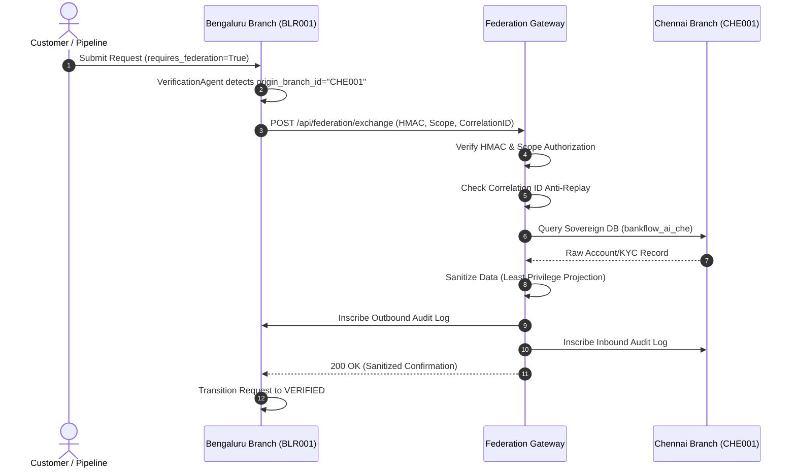

# BankFlow AI – Multi-Branch Federation Architecture

## Executive Overview
BankFlow AI implements a decentralized, simulated multi-branch federation architecture that allows sovereign branch systems to securely collaborate, verify customer credentials, and confirm service prerequisites without exposing underlying databases or violating customer privacy boundaries.

The federation network is composed of three simulated fictional branches:
1. **Bengaluru Branch** (`BLR001` - Karnataka)
2. **Chennai Branch** (`CHE001` - Tamil Nadu)
3. **Hyderabad Branch** (`HYD001` - Telangana)

---

## 1. Branch Topology & Sovereign Database Isolation
Each bank branch operates as an independent banking entity with its own dedicated PostgreSQL database, private customer records, synthetic accounts, employees, and Mesa multi-agent execution pool:

```
+---------------------+     +---------------------+     +---------------------+
|  Bengaluru Branch   |     |   Chennai Branch    |     |  Hyderabad Branch   |
|      (BLR001)       |     |      (CHE001)       |     |      (HYD001)       |
|  bankflow_ai_blr    |     |  bankflow_ai_che    |     |  bankflow_ai_hyd    |
+----------+----------+     +----------+----------+     +----------+----------+
           |                           |                           |
           +---------------------------+---------------------------+
                                       |
                         +-------------v-------------+
                         |    Federation Gateway     |
                         |  - HMAC Authentication    |
                         |  - Scope Access Control   |
                         |  - Anti-Replay Cache      |
                         |  - Data Sanitization      |
                         |  - Dual Audit Logging     |
                         +---------------------------+
```

### Branch Specifications
| Branch Code | Branch Name | Location | Sovereign Database | Default Agent Pool | Workload Focus |
|:---:|:---:|:---:|:---:|:---:|:---:|
| `BLR001` | Bengaluru Central | Bengaluru, Karnataka | `bankflow_ai_blr` | 4 Request Agents, 4 Service Agents | Retail & Corporate Tech Banking |
| `CHE001` | Chennai Metro | Chennai, Tamil Nadu | `bankflow_ai_che` | 4 Request Agents, 4 Service Agents | Trade Finance & Commercial Banking |
| `HYD001` | Hyderabad Cyber | Hyderabad, Telangana | `bankflow_ai_hyd` | 4 Request Agents, 4 Service Agents | Retail Savings & Consumer Credit |

---

## 2. Central Federation Gateway
The **Federation Gateway** acts as the single point of entry and policy enforcement for all cross-branch communication. Branches never connect directly to other branches' databases.

### Core Security Controls
1. **Service Authentication via HMAC SHA-256**:
   - Every initiating branch request is authenticated using pre-shared branch secrets (`BLR_BRANCH_SECRET`, `CHE_BRANCH_SECRET`, `HYD_BRANCH_SECRET`).
   - Constant-time string comparison (`hmac.compare_digest`) prevents timing side-channel attacks.
   - Credentials and hashes are never emitted in API responses, logs, or exceptions.
2. **Strict Scope-Based Authorization**:
   Only three permitted information scopes are defined:
   - `ACCOUNT_STATUS_CONFIRMATION`: Verifies whether an account is active and owned by the specified customer.
   - `CUSTOMER_KYC_VERIFICATION`: Confirms synthetic customer identity and KYC compliance status.
   - `SERVICE_ELIGIBILITY_CONFIRMATION`: Checks cross-branch eligibility for specific banking services.
3. **Least Privilege Data Sanitization**:
   - The gateway projects database query results strictly onto permitted response fields.
   - Internal database primary keys, password hashes, encryption keys, synthetic balances, and internal audit logs are stripped prior to transmission.
4. **Anti-Replay Protection & Idempotency**:
   - Each cross-branch exchange requires a globally unique UUID `correlation_id`.
   - The gateway maintains an in-memory or database-backed correlation index.
   - Duplicate correlation IDs are rejected immediately with `409 Conflict` (`REJECTED_DUPLICATE_CORRELATION`).
5. **Dual-Branch Audit Logging**:
   - Every exchange generates two immutable audit records:
     1. In the source branch database (logging outbound query intent).
     2. In the destination branch database (logging inbound data inspection).
   - In addition, an event is recorded in the gateway registry (`federation_events` table).

---

## 3. Data Flow Specification



---

## 4. API Specification

### `POST /api/federation/exchange`
Executes an authenticated cross-branch information exchange.

**Request Headers**:
- `X-Branch-Key`: `<branch_api_key_or_secret>`

**Request Body**:
```json
{
  "source_branch_id": "BLR001",
  "destination_branch_id": "CHE001",
  "requested_scope": "ACCOUNT_STATUS_CONFIRMATION",
  "request_id": "BFA-2026-BLR-0012",
  "correlation_id": "CORR-FED-8F3B92E1C4",
  "query_params": {
    "synthetic_account_number": "ACC-CHE-1001",
    "customer_code": "CUST-CHE-0001"
  }
}
```

**Response Body (200 OK)**:
```json
{
  "federation_event_id": "FED-EVT-7A8B9C",
  "correlation_id": "CORR-FED-8F3B92E1C4",
  "source_branch_id": "BLR001",
  "destination_branch_id": "CHE001",
  "requested_scope": "ACCOUNT_STATUS_CONFIRMATION",
  "authorization_result": "AUTHORIZED",
  "status": "SUCCESS",
  "timestamp": "2026-11-19T06:35:12.482Z",
  "data": {
    "synthetic_account_number": "ACC-CHE-1001",
    "account_status": "ACTIVE",
    "is_confirmed": true,
    "branch_id": "CHE001"
  },
  "error_message": null
}
```

### `GET /api/federation/branches`
Returns metadata and operational status for all federated branches.

### `GET /api/federation/statistics`
Provides aggregate metrics: total exchanges, success rates, rejection rates, and recent events.

### `GET /api/federation/events`
Returns paginated federation telemetry log for supervisory oversight.

---

## 5. Security & Isolation Guarantees
- **No Direct Cross-DB Access**: SQL connections are established only within designated branch sessions. A SQL injection in Branch A cannot read or modify Branch B.
- **Fail-Safe Default**: If destination branch database is unreachable or offline, the gateway returns `REJECTED_DESTINATION_UNAVAILABLE` without hanging or cascading errors.
- **Role-Based Protection**: Customers are strictly forbidden (`403 Forbidden`) from accessing federation endpoints; only bank employees and supervisors may inspect federation dashboards.
